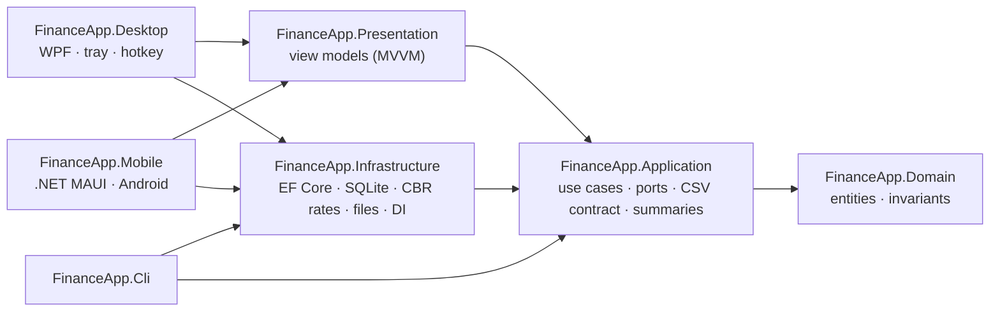

# FinanceApp


[](LICENSE)

**English** | [Русский](README.ru.md)

A Windows desktop app for personal finance tracking, built around one idea: **recording a transaction should take five seconds.** A global hotkey opens a one-line entry box; a banking-style main window keeps accounts, envelopes for savings goals, transfers and summaries for any period.

> **Status:** the Windows app is usable day to day (milestones 1–4; README screenshots are the last bit) — 572 automated tests. The Android app 1.0 covers the same ground on the phone and more: quick entry, operations, accounts and envelopes, summaries, recurring operations, limits, debts, a PIN lock and a widget ([Android](#android)). See the [roadmap](#roadmap).

## Features

- **Quick entry from anywhere.** The app lives in the tray; a global hotkey (Ctrl+Alt+M by default, reassignable) opens a one-line box. Type `350 еда кофе`, press Enter — done. A live preview under the line shows how it was understood before you save.
- **Accounts and envelopes.** Regular accounts to pay from, and envelopes — separate piggy banks such as «Car» or «Vacation», with an optional goal and date. Fill an envelope, take money back or spend straight from it.
- **Main window.** Accounts and envelopes with balances on the left, operations grouped by day on the right; forms with category tiles instead of syntax; totals in a currency of your choice, split into accounts and savings; your own categories.
- **Multi-currency accounts.** Each account has a currency; amounts are converted to a base currency at the Central Bank of Russia rate **fixed on the transaction date**, so past months never drift.
- **Offline first.** Local SQLite database; exchange rates are cached and the latest known rate is used (and flagged) when there is no network.
- **Your own rates.** Abroad the bank's rate is what counts, and without the CBR there may be no rate at all: set your own for a day, a week, a month or until removed. It replaces the CBR rate in the totals and new operations; a rate typed in a form can be remembered the same way.
- **Recurring operations.** Rent, subscriptions, the salary: mark an operation «repeat every week / month / year», and on its day the phone's home screen offers to record it (the amount can be corrected) or skip it.
- **Monthly limits.** A limit per expense category, with a bar in the summary and a warning on the home screen from 80 %.
- **Month comparison and forecast** (phone, «Итоги → Сравнить месяцы»): any two months side by side — totals, categories, what grew most; the current month is compared to the same day by default. For the current month: what can be spent a day, the expected spending and free money by the end of the month, the recurring bills still to come and the day each limit runs out at this pace.
- **Your currencies** (phone, «Ещё → Валюты»): add or remove the currencies offered in forms, rates, debts and the totals — tenge without a tenge account, or only Belarusian rubles. The base currency and those of the accounts always stay. The Belarusian ruble shows its 2026 sign («Б» with a stroke) from a small font of the app, as Unicode has no code point for it yet; «Br» in the widget and on the desktop.
- **Debts** (phone, «Ещё → Долги»): who owes you and whom you owe, with the date agreed, partial repayments and overdue ones marked. A notebook apart from the accounts: it changes no balance and no summary.
- **On the phone:** restore from a copy (also on a new phone), PIN and fingerprint lock, shortcuts on the app icon («Расход», «Доход», «Перевод») and a resizable home-screen widget: the total and buttons for each kind of operation, the month so far when tall (amounts hidden under the PIN unless allowed).
- **Daily backups.** A consistent copy of the database is made once a day on start; the latest 14 are kept ([ADR 0012](docs/adr/0012-database-backups.md)).
- **Summaries for any period.** Week, month, quarter, year, a custom range or all time: income, expenses, money put into envelopes, balance, a month chart, expenses by category and comparison with the previous period.
- **Transfers between currencies.** Enter what was sent and either what arrived or the rate; the result is shown before saving.
- **Open data.** Optional CSV export rewritten atomically after every change — readable by spreadsheets and note-taking apps such as Obsidian.
- **Safe import.** All-or-nothing CSV import with dry run, duplicate detection and a per-month check against the source file.

### Quick-entry syntax

`[+|>]<amount>[currency] [category] [note…] [date] [@account]` — see [ADR 0009](docs/adr/0009-quick-entry-syntax.md).

| Line | Result |
|---|---|
| `350 еда кофе` | expense 350, «Еда», note «кофе», today |
| `200 кофе` | category suggested from previous notes → «Еда» |
| `+50000 зарплата` | income |
| `>10 000 машина` | into the «Машина» envelope from the default account |
| `1200 тр такси вчера` | «Транспорт» by prefix, dated yesterday |
| `20 еда ужин @карта usd` | dollar account, converted at the CBR rate of the day |
| `20 eur еда ужин` | receipt in euros from the default ruble card: charged at the CBR rate, «20 EUR» kept in the note (also `20€`, `€20`, `20 евро`) |

Categories and accounts match by prefix; ambiguities are shown instead of guessed. The default account is the last base-currency account used for the same type.

## Architecture

Clean architecture: dependencies point inwards, the core knows nothing about the UI, the database or any integration.



| Project | Responsibility |
|---|---|
| `FinanceApp.Domain` | `Transaction`, `Category`, `Account`, `CurrencyCode`, `YearMonth`; invariants such as positive amounts and category/type consistency. No dependencies. |
| `FinanceApp.Application` | Use cases (`TransactionService`, `QuickEntryService`, `CsvImportService`, `CsvExportService`), the quick-entry parser, `SummaryCalculator`, `ExchangeRateService`, the CSV contract and the ports they need. |
| `FinanceApp.Infrastructure` | EF Core + SQLite repositories and migrations, CBR rate source with a local cache, atomic file writer, JSON settings, DI registration shared by all front ends. |
| `FinanceApp.Presentation` | View models on CommunityToolkit.Mvvm with no WPF dependency — window behaviour is unit-tested. |
| `FinanceApp.Desktop` | WPF tray app: global hotkey via `RegisterHotKey`, a pre-created quick-entry window (shown instantly), hotkey settings, single instance. |
| `FinanceApp.Mobile` | Android app on .NET MAUI with its own database on the phone: five tabs over the same view models as the desktop window. Built on its own — it needs the MAUI workload. |
| `FinanceApp.Cli` | `finance` command-line tool built on the same service graph as the desktop app. |

### Key design decisions

Each decision is recorded as an [ADR](docs/adr/README.md).

- **Money is `decimal`, rates are fixed per transaction** ([ADR 0002](docs/adr/0002-multi-currency.md)). The amount is stored in the account currency together with the rate to the base currency on that date.
- **Integrations are listeners, not core code** ([ADR 0004](docs/adr/0004-obsidian-export-is-optional.md)). Use cases publish "data changed"; the CSV export coordinator debounces, rewrites the file via a temp file and `File.Replace`, and retries when the file is locked. An export failure becomes a status, never an error for the user saving a transaction.
- **A stable CSV contract** ([ADR 0008](docs/adr/0008-csv-contract-extension.md)). The first six columns never change; currency and id are appended on the right, which makes export → import lossless.
- **Idempotent import.** Rows with an `id` are upserted; rows without one are matched by content, counting duplicates, so importing the same file twice adds nothing.

## Getting started

Requires the [.NET 10 SDK](https://dotnet.microsoft.com/download/dotnet/10.0) on Windows.

```bash
dotnet build
dotnet test
dotnet run --project src/FinanceApp.Desktop -- --main
dotnet run --project src/FinanceApp.Cli -- --help
```

Or double-click `run-app.cmd` in the repository root. `--main` opens the main window at once; without it the desktop app starts in the tray: press the hotkey (Ctrl+Alt+M) or click the tray icon to enter a transaction. If the hotkey is taken by another program, the app asks for another combination; it can be changed later in the settings (tray menu → «Настройки…», or ⚙ in the main window), together with start with Windows, the CSV export file and backups.

Data is stored in `%LocalAppData%\FinanceApp` (`finance.db`, `settings.json`, `backups\`). Override it with `--data-dir <path>` or the `FINANCEAPP_DATA_DIR` environment variable.

### Install

`install.cmd` builds a single self-contained `FinanceApp.exe` (about 70 MB, no .NET needed to run it) and installs it for the current user into `%LocalAppData%\Programs\FinanceApp` with a Start menu shortcut — no admin rights. A running copy is closed first (`FinanceApp.exe --exit`). `install.cmd -Uninstall` removes the program and its autostart entry; the data stays. `publish.cmd` only builds the exe into `artifacts\FinanceApp` for a portable copy.

### Android

The phone app (`src/FinanceApp.Mobile`, [ADR 0013](docs/adr/0013-android-app.md)) is not part of `FinanceApp.slnx` and builds on Windows, Linux or macOS. It needs the .NET 10 SDK, the MAUI Android workload, an Android SDK (platform 36 and build-tools) and JDK 17 or newer:

```bash
dotnet workload install maui-android
```

```bash
dotnet build src/FinanceApp.Mobile -t:InstallAndroidDependencies -f net10.0-android -p:AndroidSdkDirectory=<sdk folder> -p:AcceptAndroidSDKLicenses=True
```

```bash
tools/build-android.sh <sdk folder>
```

The second command downloads the Android SDK packages the project needs (skip it if Android Studio already installed them); on Windows run `tools\build-android.ps1 -AndroidSdk <sdk folder>` instead of the `.sh`. The result is `artifacts/android/FinanceApp-debug.apk`, signed with the local debug key: copy it to the phone and open it (allow installing apps from this source). The phone keeps its own database — it is not synced with the desktop app. The first start is a short tour of the app, then the base currency (fixed from then on) and what is on the card and in cash now, plus an optional first envelope and whether to show the quick-entry line; the tour can be opened again from «Ещё». Then the app has five tabs:

- **Главная** — buttons for the expense, income and transfer forms and, if switched on in «Ещё → Настройки» or at the first run, the quick-entry line with its live preview (off by default: not everyone likes to type a syntax); the total and the last 30 days of operations (tap one to edit it).
- **Операции** — a month by day for all accounts or one, filters by type, search, swipe left to delete with «Вернуть» to undo; filling and emptying an envelope.
- **Счета** — accounts and envelopes with balances, goals and progress; totals in any currency; new and hidden accounts.
- **Итоги** — any period: money in and out, where the income went, insights, the pace of spending against the previous period, categories, the biggest expenses, envelopes.
- **Ещё** — categories, CSV and a copy of the database through the share sheet (the CSV imports into the desktop app with `finance import`).

#### Release

The signed APK is published in [GitHub Releases](https://github.com/Scr1pt445/FinanceApp/releases): a tag `v1.0.0` (or «Run workflow» on main, which tags the version of the build) runs `.github/workflows/release.yml`, which builds it with `tools/build-android-release.sh`, describes it with `docs/release-notes/<tag>.md` (Russian and English; a change to that file on main updates a published release) and the key from the repository secrets (`ANDROID_KEYSTORE_BASE64`, `ANDROID_KEYSTORE_PASSWORD`, `ANDROID_KEY_ALIAS`). The same script builds it locally with the key passed through `FINANCEAPP_KEYSTORE`, `FINANCEAPP_KEY_ALIAS` and `FINANCEAPP_KEYSTORE_PASSWORD`; the key itself never goes into the repository, and every update has to be signed with it.

A debug APK and the release one are signed with different keys, so Android will not install one over the other. To move: «Ещё → Данные → Поделиться копией» in the old app and keep the file, remove the app, install the release and pick «Перенести данные из копии» on its first screen.

The release build is not debuggable and keeps no Android backup (the database and the PIN hash stay on the phone; the app makes its own copies). With the PIN on, wrong tries are counted across restarts and the app's last screen is hidden from the recent apps (Android 13+); a copy with triggers or views is refused on restore.

### CLI examples

```bash
finance init --base-currency RUB
finance q "350 еда кофе вчера"                        # same one-line syntax as the window
finance add 350 --category Еда --note "coffee"
finance accounts add "Card USD" --currency USD
finance add 20 --category Еда --account "Card USD"    # converted at today's CBR rate
finance summary --month 2026-10
finance import legacy.csv --default-account Карта --dry-run
finance config export --enable --path "C:\Notes\Finance\transactions.csv"
```

Run `finance <command> --help` for all options.

## CSV format

```csv
date,type,amount,category,account,note,currency,original_amount,id
2026-10-07,expense,350,Еда,Карта,"coffee, croissant",RUB,350,01a1…
2026-10-07,expense,1714.23,Еда,Card USD,dinner,USD,20,01a1…
```

UTF-8 without BOM, LF line endings, RFC 4180 quoting, `amount` always in the base currency. Full contract: [requirements, section 5](docs/requirements.md#5-csv-export-contract).

## Testing

572 tests on xUnit v3 and Microsoft Testing Platform (on Linux one Windows-only file-lock test is skipped):

- **Core tests** — domain invariants, the quick-entry parser (amounts, prefixes, dates, accounts, ambiguities), category hints, CSV writer/reader (byte-level checks for BOM, quoting and culture independence), summaries, exchange-rate fallback logic, export coordinator (debounce, retries, failure status), view models of the main window (operations, forms, summaries, categories, totals currency), the quick-entry and hotkey windows and the phone's home screen.
- **Infrastructure tests** — run against a real SQLite file and the real file system: migrations and seeding, decimal/date round-trips, atomic replace with a locked target, CBR parsing with a fake HTTP handler, end-to-end add → edit → delete → CSV, import idempotency and export → import round-trip, the phone's home screen and data sharing through the shared scoped backends.
- **Phone screens** (`tests/FinanceApp.Mobile.Tests`, needs the MAUI workload, runs in the `android` CI job) — every page is built from the app's real service graph under its theme on a SQLite file, without a device: the first-run setup, start-up, the five tabs, the currency and period chips, the forms coming and going, the theme matching the palette. A page built before the theme — the crash of the first APK — fails here.

## Roadmap

| Milestone | Scope | Status |
|---|---|:-:|
| 1. Core | Domain, SQLite, exchange rates, CSV export/import, CLI, tests | ✅ |
| 2. Quick entry | Tray icon, global hotkey, one-line entry window, input parser | ✅ |
| 3. Main window | Accounts, envelopes, transfers, operations, forms, summaries, categories | ✅ |
| 4. Polish | Settings window, autostart, backups, single-file build and install, app icon ✅; screenshots | ⏳ |
| 5. Android | Standalone phone app on .NET MAUI with its own database, sharing the core — [ADR 0013](docs/adr/0013-android-app.md). 5.1 the core and quick entry ✅, 5.2 accounts and operations ✅, 5.3 summaries, categories, sharing ✅; 5.4 signed release APK ✅ (README screenshots to come) | ✅ |

Details: [product requirements](docs/requirements.md).

## License

[MIT](LICENSE)
