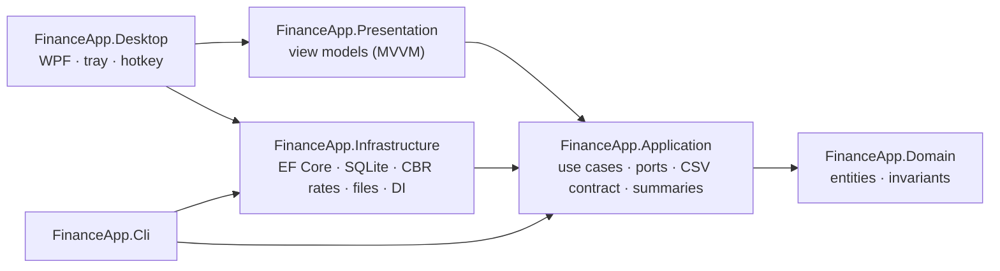

# FinanceApp


[](LICENSE)

**English** | [Русский](README.ru.md)

A Windows desktop app for personal finance tracking, built around one idea: **recording a transaction should take five seconds.** A global hotkey opens a one-line entry box; monthly totals, multi-currency accounts and an open CSV export do the rest.

> **Status:** milestones 1–2 of 4 are done — the core and the tray app with the quick-entry window, 243 automated tests. The main window with the transaction list is next. See the [roadmap](#roadmap).

## Features

- **Quick entry from anywhere.** The app lives in the tray; a global hotkey (Ctrl+Alt+M by default, reassignable) opens a one-line box. Type `350 еда кофе`, press Enter — done. A live preview under the line shows how it was understood before you save.
- **Multi-currency accounts.** Each account has a currency; amounts are converted to a base currency at the Central Bank of Russia rate **fixed on the transaction date**, so past months never drift.
- **Offline first.** Local SQLite database; exchange rates are cached and the latest known rate is used (and flagged) when there is no network.
- **Monthly summary.** Income, expenses, savings, balance, expenses by category and comparison with the previous month.
- **Open data.** Optional CSV export rewritten atomically after every change — readable by spreadsheets and note-taking apps such as Obsidian.
- **Safe import.** All-or-nothing CSV import with dry run, duplicate detection and a per-month check against the source file.

### Quick-entry syntax

`[+|>]<amount> [category] [note…] [date] [@account]` — see [ADR 0009](docs/adr/0009-quick-entry-syntax.md).

| Line | Result |
|---|---|
| `350 еда кофе` | expense 350, «Еда», note «кофе», today |
| `200 кофе` | category suggested from previous notes → «Еда» |
| `+50000 зарплата` | income |
| `>10 000 копилка @вклад` | saving to the «Вклад» account |
| `1200 тр такси вчера` | «Транспорт» by prefix, dated yesterday |
| `20 еда ужин @карта usd` | dollar account, converted at the CBR rate of the day |

Categories and accounts match by prefix; ambiguities are shown instead of guessed. The default account is the last base-currency account used for the same type.

## Architecture

Clean architecture: dependencies point inwards, the core knows nothing about the UI, the database or any integration.



| Project | Responsibility |
|---|---|
| `FinanceApp.Domain` | `Transaction`, `Category`, `Account`, `CurrencyCode`, `YearMonth`; invariants such as positive amounts and category/type consistency. No dependencies. |
| `FinanceApp.Application` | Use cases (`TransactionService`, `QuickEntryService`, `CsvImportService`, `CsvExportService`), the quick-entry parser, `SummaryCalculator`, `ExchangeRateService`, the CSV contract and the ports they need. |
| `FinanceApp.Infrastructure` | EF Core + SQLite repositories and migrations, CBR rate source with a local cache, atomic file writer, JSON settings, DI registration shared by all front ends. |
| `FinanceApp.Presentation` | View models on CommunityToolkit.Mvvm with no WPF dependency — window behaviour is unit-tested. |
| `FinanceApp.Desktop` | WPF tray app: global hotkey via `RegisterHotKey`, a pre-created quick-entry window (shown instantly), hotkey settings, single instance. |
| `FinanceApp.Cli` | `finance` command-line tool built on the same service graph as the desktop app. |

### Key design decisions

Each decision is recorded as an [ADR](docs/adr/README.md).

- **Money is `decimal`, rates are fixed per transaction** ([ADR 0002](docs/adr/0002-multi-currency.md)). The amount is stored in the account currency together with the rate to the base currency on that date.
- **Integrations are listeners, not core code** ([ADR 0004](docs/adr/0004-obsidian-export-is-optional.md)). Use cases publish "data changed"; the CSV export coordinator debounces, rewrites the file via a temp file and `File.Replace`, and retries when the file is locked. An export failure becomes a status, never an error for the user saving a transaction.
- **A stable CSV contract** ([ADR 0008](docs/adr/0008-csv-contract-extension.md)). The first six columns never change; currency and id are appended on the right, which makes export → import lossless.
- **Idempotent import.** Rows with an `id` are upserted; rows without one are matched by content, counting duplicates, so importing the same file twice adds nothing.

## Getting started

Requires the [.NET 10 SDK](https://dotnet.microsoft.com/download/dotnet/10.0) on Windows.

```bash
dotnet build
dotnet test
dotnet run --project src/FinanceApp.Desktop
dotnet run --project src/FinanceApp.Cli -- --help
```

The desktop app starts in the tray: press the hotkey (Ctrl+Alt+M) or click the tray icon to enter a transaction. If the hotkey is taken by another program, the app asks for another combination; it can be changed later from the tray menu.

Data is stored in `%LocalAppData%\FinanceApp` (`finance.db`, `settings.json`). Override it with `--data-dir <path>` or the `FINANCEAPP_DATA_DIR` environment variable.

### CLI examples

```bash
finance init --base-currency RUB
finance q "350 еда кофе вчера"                        # same one-line syntax as the window
finance add 350 --category Еда --note "coffee"
finance accounts add "Card USD" --currency USD
finance add 20 --category Еда --account "Card USD"    # converted at today's CBR rate
finance summary --month 2026-10
finance import legacy.csv --default-account Карта --dry-run
finance config export --enable --path "C:\Notes\Finance\transactions.csv"
```

Run `finance <command> --help` for all options.

## CSV format

```csv
date,type,amount,category,account,note,currency,original_amount,id
2026-10-07,expense,350,Еда,Карта,"coffee, croissant",RUB,350,01a1…
2026-10-07,expense,1714.23,Еда,Card USD,dinner,USD,20,01a1…
```

UTF-8 without BOM, LF line endings, RFC 4180 quoting, `amount` always in the base currency. Full contract: [requirements, section 5](docs/requirements.md#5-csv-export-contract).

## Testing

243 tests on xUnit v3 and Microsoft Testing Platform:

- **Core tests** — domain invariants, the quick-entry parser (amounts, prefixes, dates, accounts, ambiguities), category hints, CSV writer/reader (byte-level checks for BOM, quoting and culture independence), summaries, exchange-rate fallback logic, export coordinator (debounce, retries, failure status), view models of the quick-entry and hotkey windows.
- **Infrastructure tests** — run against a real SQLite file and the real file system: migrations and seeding, decimal/date round-trips, atomic replace with a locked target, CBR parsing with a fake HTTP handler, end-to-end add → edit → delete → CSV, import idempotency and export → import round-trip.

## Roadmap

| Milestone | Scope | Status |
|---|---|:-:|
| 1. Core | Domain, SQLite, exchange rates, CSV export/import, CLI, tests | ✅ |
| 2. Quick entry | Tray icon, global hotkey, one-line entry window, input parser | ✅ |
| 3. Main window | Transaction list, filters, editing, monthly summary | ⏳ |
| 4. Polish | Catalog management, settings, autostart, backups, screenshots | |

Details: [product requirements](docs/requirements.md).

## License

[MIT](LICENSE)
