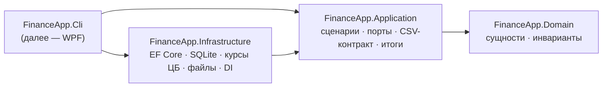

# FinanceApp

[](https://github.com/Scr1pt445/FinanceApp/actions/workflows/ci.yml)


[](LICENSE)

[English](README.md) | **Русский**

Десктопное приложение для учёта личных финансов под Windows. Главная идея — **операция записывается за пять секунд**: глобальная горячая клавиша открывает строку ввода, а итоги месяца, мультивалютные счета и открытый CSV-экспорт делают остальное.

> **Статус:** готов этап 1 из 4 — ядро (домен, хранение, курсы валют, импорт и экспорт CSV), консольный интерфейс и 143 автотеста. Следующий шаг — окно быстрого ввода на WPF. См. [план](#план).

## Возможности

- **Мультивалютные счета.** У каждого счёта своя валюта; суммы пересчитываются в базовую валюту по курсу ЦБ РФ, **зафиксированному на дату операции**, поэтому прошлые месяцы не «плывут».
- **Работа офлайн.** Локальная база SQLite; курсы кэшируются, без сети берётся последний известный курс с пометкой об этом.
- **Итоги месяца.** Доходы, расходы, накопления, остаток, расходы по категориям и сравнение с прошлым месяцем.
- **Открытые данные.** Необязательный экспорт в CSV, который атомарно перезаписывается после каждого изменения, — его читают таблицы и приложения для заметок вроде Obsidian.
- **Безопасный импорт.** Всё или ничего, режим dry run, поиск дублей и сверка сумм по месяцам с исходным файлом.

## Архитектура

Чистая архитектура: зависимости направлены внутрь, ядро не знает ни про UI, ни про базу данных, ни про интеграции.



| Проект | Ответственность |
|---|---|
| `FinanceApp.Domain` | `Transaction`, `Category`, `Account`, `CurrencyCode`, `YearMonth`; инварианты (положительная сумма, соответствие категории типу операции). Без зависимостей. |
| `FinanceApp.Application` | Сценарии (`TransactionService`, `CsvImportService`, `CsvExportService`), `SummaryCalculator`, `ExchangeRateService`, CSV-контракт и нужные им порты. |
| `FinanceApp.Infrastructure` | Репозитории и миграции EF Core + SQLite, источник курсов ЦБ с локальным кэшем, атомарная запись файлов, настройки в JSON, регистрация в DI для всех интерфейсов. |
| `FinanceApp.Cli` | Консольный инструмент `finance` на том же графе сервисов, что и будущее десктоп-приложение. |

### Ключевые решения

Каждое решение оформлено как [ADR](docs/adr/README.md) (на английском).

- **Деньги — `decimal`, курс фиксируется в операции** ([ADR 0002](docs/adr/0002-multi-currency.md)).
- **Интеграции — подписчики, а не часть ядра** ([ADR 0004](docs/adr/0004-obsidian-export-is-optional.md)). Сценарии сообщают «данные изменились»; координатор экспорта выдерживает паузу, перезаписывает файл через временный файл и `File.Replace` и повторяет попытку, если файл занят. Ошибка экспорта становится статусом и не мешает сохранить операцию.
- **Стабильный CSV-контракт** ([ADR 0008](docs/adr/0008-csv-contract-extension.md)). Первые шесть колонок неизменны, валюта и id добавлены справа — экспорт → импорт проходит без потерь.
- **Идемпотентный импорт.** Строки с `id` обновляются, строки без `id` сопоставляются по содержимому с учётом повторов — повторный импорт ничего не добавляет.

## Запуск

Нужен [.NET 10 SDK](https://dotnet.microsoft.com/download/dotnet/10.0) под Windows.

```bash
dotnet build
dotnet test
dotnet run --project src/FinanceApp.Cli -- --help
```

Данные хранятся в `%LocalAppData%\FinanceApp` (`finance.db`, `settings.json`). Другой каталог — `--data-dir <путь>` или переменная `FINANCEAPP_DATA_DIR`.

### Примеры CLI

```bash
finance init --base-currency RUB
finance add 350 --category Еда --note "кофе"
finance accounts add "Карта USD" --currency USD
finance add 20 --category Еда --account "Карта USD"    # по сегодняшнему курсу ЦБ
finance summary --month 2026-10
finance import legacy.csv --default-account Карта --dry-run
finance config export --enable --path "C:\Notes\Finance\transactions.csv"
```

Все параметры — `finance <команда> --help`.

## Формат CSV

```csv
date,type,amount,category,account,note,currency,original_amount,id
2026-10-07,expense,350,Еда,Карта,"кофе, круассан",RUB,350,01a1…
2026-10-07,expense,1714.23,Еда,Карта USD,ужин,USD,20,01a1…
```

UTF-8 без BOM, переводы строк LF, кавычки по RFC 4180, `amount` всегда в базовой валюте. Полный контракт — в [требованиях, раздел 5](docs/requirements.md#5-csv-export-contract).

## Тесты

143 теста на xUnit v3 и Microsoft Testing Platform:

- **Core** — инварианты домена, запись и чтение CSV (побайтовые проверки BOM, кавычек и независимости от культуры), итоги, логика запасного курса, координатор экспорта (пауза, повторы, статус ошибки).
- **Infrastructure** — на настоящем файле SQLite и файловой системе: миграции и стартовые данные, точность `decimal` и дат, атомарная замена занятого файла, разбор ответа ЦБ с фейковым HTTP-обработчиком, сквозной сценарий «добавил → изменил → удалил → CSV», идемпотентность импорта и экспорт → импорт.

## План

| Этап | Содержание | Статус |
|---|---|:-:|
| 1. Ядро | Домен, SQLite, курсы валют, экспорт и импорт CSV, CLI, тесты | ✅ |
| 2. Быстрый ввод | Трей, глобальная горячая клавиша, окно ввода в одну строку, парсер | ⏳ |
| 3. Основное окно | Список операций, фильтры, правка, итоги месяца | |
| 4. Полировка | Справочники, настройки, автозапуск, резервные копии, скриншоты | |

Подробнее — в [требованиях к продукту](docs/requirements.md) (на английском).

## Лицензия

[MIT](LICENSE)
