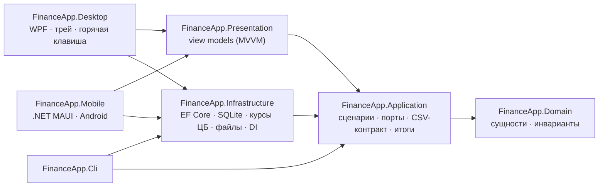

# FinanceApp


[](LICENSE)

[English](README.md) | **Русский**

Десктопное приложение для учёта личных финансов под Windows. Главная идея — **операция записывается за пять секунд**: глобальная горячая клавиша открывает строку ввода, а основное окно в стиле банковского приложения держит счета, конверты для накоплений, переводы и итоги за любой период.

> **Статус:** приложение для Windows готово к ежедневному использованию (этапы 1–4, осталось добавить скриншоты в README) — 454 автотеста. Отдельное приложение для Android умеет на телефоне то же самое: быстрый ввод, операции, счета и конверты, итоги ([Android](#android)). См. [план](#план).

## Возможности

- **Быстрый ввод из любого окна.** Приложение живёт в трее; глобальная горячая клавиша (по умолчанию Ctrl+Alt+M, можно переназначить) открывает строку ввода. Пишете `350 еда кофе`, Enter — готово. Под строкой видно, как она понята, ещё до сохранения.
- **Счета и конверты.** Обычные счета, с которых платите, и конверты — отдельные копилки вроде «Машина» или «Отдых», с необязательной целью и сроком. Конверт можно пополнить, взять из него или потратить прямо из него.
- **Основное окно.** Слева счета и конверты с остатками, справа операции по дням; формы с плитками категорий вместо синтаксиса; «Всего» в выбранной валюте отдельно по счетам и накоплениям; свои категории.
- **Мультивалютные счета.** У каждого счёта своя валюта; суммы пересчитываются в базовую валюту по курсу ЦБ РФ, **зафиксированному на дату операции**, поэтому прошлые месяцы не «плывут».
- **Работа офлайн.** Локальная база SQLite; курсы кэшируются, без сети берётся последний известный курс с пометкой об этом.
- **Свои курсы.** За границей важен курс банка, а без связи с ЦБ курса может не быть вовсе: задайте свой на день, неделю, месяц или пока не уберёте. Он заменяет курс ЦБ в итогах и новых операциях; курс, введённый в форме, можно запомнить так же.
- **Резервные копии.** Раз в день при запуске делается целостная копия базы; хранятся последние 14 ([ADR 0012](docs/adr/0012-database-backups.md)).
- **Итоги за любой период.** Неделя, месяц, квартал, год, произвольный диапазон или всё время: доходы, расходы, отложено в конверты, остаток, график по месяцам, расходы по категориям и сравнение с прошлым периодом.
- **Переводы между валютами.** Введите, сколько отправили, и либо сколько пришло, либо курс — результат виден до сохранения.
- **Открытые данные.** Необязательный экспорт в CSV, который атомарно перезаписывается после каждого изменения, — его читают таблицы и приложения для заметок вроде Obsidian.
- **Безопасный импорт.** Всё или ничего, режим dry run, поиск дублей и сверка сумм по месяцам с исходным файлом.

### Синтаксис быстрого ввода

`[+|>]<сумма>[валюта] [категория] [комментарий…] [дата] [@счёт]` — подробнее в [ADR 0009](docs/adr/0009-quick-entry-syntax.md).

| Строка | Результат |
|---|---|
| `350 еда кофе` | расход 350, «Еда», комментарий «кофе», сегодня |
| `200 кофе` | категория по прошлым записям → «Еда» |
| `+50000 зарплата` | доход |
| `>10 000 машина` | в конверт «Машина» со счёта по умолчанию |
| `1200 тр такси вчера` | «Транспорт» по началу слова, дата — вчера |
| `20 еда ужин @карта usd` | долларовый счёт, пересчёт по курсу ЦБ на этот день |
| `20 eur еда ужин` | чек в евро с рублёвой карты по умолчанию: списание по курсу ЦБ, «20 EUR» остаётся в заметке (также `20€`, `€20`, `20 евро`) |

Категории и счета ищутся по началу названия; неоднозначности показываются, а не угадываются. Счёт по умолчанию — последний счёт в базовой валюте, использованный для того же типа операции.

## Архитектура

Чистая архитектура: зависимости направлены внутрь, ядро не знает ни про UI, ни про базу данных, ни про интеграции.



| Проект | Ответственность |
|---|---|
| `FinanceApp.Domain` | `Transaction`, `Category`, `Account`, `CurrencyCode`, `YearMonth`; инварианты (положительная сумма, соответствие категории типу операции). Без зависимостей. |
| `FinanceApp.Application` | Сценарии (`TransactionService`, `QuickEntryService`, `CsvImportService`, `CsvExportService`), парсер быстрого ввода, `SummaryCalculator`, `ExchangeRateService`, CSV-контракт и нужные им порты. |
| `FinanceApp.Infrastructure` | Репозитории и миграции EF Core + SQLite, источник курсов ЦБ с локальным кэшем, атомарная запись файлов, настройки в JSON, регистрация в DI для всех интерфейсов. |
| `FinanceApp.Presentation` | View models на CommunityToolkit.Mvvm без зависимости от WPF — поведение окон покрыто модульными тестами. |
| `FinanceApp.Desktop` | WPF-приложение в трее: глобальная горячая клавиша через `RegisterHotKey`, заранее созданное окно ввода (появляется мгновенно), настройка горячей клавиши, один экземпляр. |
| `FinanceApp.Mobile` | Приложение для Android на .NET MAUI со своей базой на телефоне: пять вкладок на тех же view models, что и окно десктопа. Собирается отдельно — нужна рабочая нагрузка MAUI. |
| `FinanceApp.Cli` | Консольный инструмент `finance` на том же графе сервисов, что и десктоп-приложение. |

### Ключевые решения

Каждое решение оформлено как [ADR](docs/adr/README.md) (на английском).

- **Деньги — `decimal`, курс фиксируется в операции** ([ADR 0002](docs/adr/0002-multi-currency.md)).
- **Интеграции — подписчики, а не часть ядра** ([ADR 0004](docs/adr/0004-obsidian-export-is-optional.md)). Сценарии сообщают «данные изменились»; координатор экспорта выдерживает паузу, перезаписывает файл через временный файл и `File.Replace` и повторяет попытку, если файл занят. Ошибка экспорта становится статусом и не мешает сохранить операцию.
- **Стабильный CSV-контракт** ([ADR 0008](docs/adr/0008-csv-contract-extension.md)). Первые шесть колонок неизменны, валюта и id добавлены справа — экспорт → импорт проходит без потерь.
- **Идемпотентный импорт.** Строки с `id` обновляются, строки без `id` сопоставляются по содержимому с учётом повторов — повторный импорт ничего не добавляет.

## Запуск

Нужен [.NET 10 SDK](https://dotnet.microsoft.com/download/dotnet/10.0) под Windows.

```bash
dotnet build
dotnet test
dotnet run --project src/FinanceApp.Desktop -- --main
dotnet run --project src/FinanceApp.Cli -- --help
```

Или дважды кликните `run-app.cmd` в корне репозитория. `--main` сразу открывает основное окно; без него приложение запускается в трей: нажмите горячую клавишу (Ctrl+Alt+M) или кликните по значку, чтобы ввести операцию. Если сочетание занято другой программой, приложение сразу предложит выбрать другое; поменять его можно и позже в настройках (меню трея → «Настройки…» или ⚙ в основном окне) — там же автозапуск, файл экспорта CSV и резервные копии.

Данные хранятся в `%LocalAppData%\FinanceApp` (`finance.db`, `settings.json`, `backups\`). Другой каталог — `--data-dir <путь>` или переменная `FINANCEAPP_DATA_DIR`.

### Установка

`install.cmd` собирает один самодостаточный `FinanceApp.exe` (около 70 МБ, .NET для запуска не нужен) и ставит его для текущего пользователя в `%LocalAppData%\Programs\FinanceApp` с ярлыком в меню «Пуск» — без прав администратора. Запущенная копия сначала закрывается (`FinanceApp.exe --exit`). `install.cmd -Uninstall` удаляет программу и запись автозапуска, данные остаются. `publish.cmd` только собирает exe в `artifacts\FinanceApp` — для переносной копии.

### Android

Приложение для телефона (`src/FinanceApp.Mobile`, [ADR 0013](docs/adr/0013-android-app.md)) не входит в `FinanceApp.slnx` и собирается на Windows, Linux или macOS. Нужны .NET 10 SDK, рабочая нагрузка MAUI для Android, Android SDK (платформа 36 и build-tools) и JDK 17 или новее:

```bash
dotnet workload install maui-android
```

```bash
dotnet build src/FinanceApp.Mobile -t:InstallAndroidDependencies -f net10.0-android -p:AndroidSdkDirectory=<папка SDK> -p:AcceptAndroidSDKLicenses=True
```

```bash
tools/build-android.sh <папка SDK>
```

Вторая команда скачивает нужные проекту пакеты Android SDK (её можно пропустить, если их уже поставила Android Studio); на Windows вместо `.sh` — `tools\build-android.ps1 -AndroidSdk <папка SDK>`. Результат — `artifacts/android/FinanceApp-debug.apk`, подписанный локальным отладочным ключом: скопируйте его на телефон и откройте (разрешите установку приложений из этого источника). У телефона своя база — с десктоп-приложением она не синхронизируется. При первом запуске — короткое обучение, затем выбор основной валюты (потом не меняется) и сколько сейчас на карте и наличными, а по желанию — первый конверт и строка быстрого ввода; обучение можно открыть снова из «Ещё». Дальше в приложении пять вкладок:

- **Главная** — кнопки форм расхода, дохода и перевода и, если включить в «Ещё → Настройки» или при первом запуске, строка быстрого ввода с живым предпросмотром (по умолчанию выключена: печатать синтаксис удобно не всем); общий остаток и операции за последние 30 дней (нажатие открывает редактирование).
- **Операции** — месяц по дням по всем счетам или по одному, фильтр по типу, поиск, удаление свайпом влево с кнопкой «Вернуть»; пополнить конверт или взять из него.
- **Счета** — счета и конверты с остатками, целями и прогрессом; итоги в любой валюте; новые и скрытые счета.
- **Итоги** — за любой период: пришло и ушло, куда ушли доходы, выводы, темп трат против прошлого периода, категории, крупные траты, конверты.
- **Ещё** — категории, CSV и копия базы через «Поделиться» (CSV загружается в десктоп-приложение командой `finance import`).

### Примеры CLI

```bash
finance init --base-currency RUB
finance q "350 еда кофе вчера"                         # тот же синтаксис, что в окне
finance add 350 --category Еда --note "кофе"
finance accounts add "Карта USD" --currency USD
finance add 20 --category Еда --account "Карта USD"    # по сегодняшнему курсу ЦБ
finance summary --month 2026-10
finance import legacy.csv --default-account Карта --dry-run
finance config export --enable --path "C:\Notes\Finance\transactions.csv"
```

Все параметры — `finance <команда> --help`.

## Формат CSV

```csv
date,type,amount,category,account,note,currency,original_amount,id
2026-10-07,expense,350,Еда,Карта,"кофе, круассан",RUB,350,01a1…
2026-10-07,expense,1714.23,Еда,Карта USD,ужин,USD,20,01a1…
```

UTF-8 без BOM, переводы строк LF, кавычки по RFC 4180, `amount` всегда в базовой валюте. Полный контракт — в [требованиях, раздел 5](docs/requirements.md#5-csv-export-contract).

## Тесты

454 теста на xUnit v3 и Microsoft Testing Platform (на Linux один тест блокировки файла, который проверяет поведение Windows, пропускается):

- **Core** — инварианты домена, парсер быстрого ввода (суммы, префиксы, даты, счета, неоднозначности), подсказки категорий, запись и чтение CSV (побайтовые проверки BOM, кавычек и независимости от культуры), итоги, логика запасного курса, координатор экспорта (пауза, повторы, статус ошибки), view models основного окна (операции, формы, итоги, категории, валюта итогов), окон быстрого ввода и горячей клавиши и главного экрана телефона.
- **Infrastructure** — на настоящем файле SQLite и файловой системе: миграции и стартовые данные, точность `decimal` и дат, атомарная замена занятого файла, разбор ответа ЦБ с фейковым HTTP-обработчиком, сквозной сценарий «добавил → изменил → удалил → CSV», идемпотентность импорта и экспорт → импорт, главный экран телефона и выгрузка данных через общие адаптеры с отдельной областью DI на вызов.
- **Экраны телефона** (`tests/FinanceApp.Mobile.Tests`, нужна рабочая нагрузка MAUI, запускаются в CI-задаче `android`) — каждая страница собирается из настоящего графа сервисов приложения, с его темой и на файле SQLite, без устройства: первая настройка, запуск, пять вкладок, выбор валюты и периода, открытие и закрытие форм, соответствие темы палитре. Страница, созданная раньше темы, — причина вылета первого APK — падает здесь.

## План

| Этап | Содержание | Статус |
|---|---|:-:|
| 1. Ядро | Домен, SQLite, курсы валют, экспорт и импорт CSV, CLI, тесты | ✅ |
| 2. Быстрый ввод | Трей, глобальная горячая клавиша, окно ввода в одну строку, парсер | ✅ |
| 3. Основное окно | Счета, конверты, переводы, операции, формы, итоги, категории | ✅ |
| 4. Полировка | Окно настроек, автозапуск, резервные копии, сборка в один файл и установка, значок ✅; скриншоты | ⏳ |
| 5. Android | Отдельное приложение для телефона на .NET MAUI со своей базой и общим ядром — [ADR 0013](docs/adr/0013-android-app.md). 5.1 ядро и быстрый ввод ✅, 5.2 счета и операции ✅, 5.3 итоги, категории, «Поделиться» ✅; подписанный релизный APK | ⏳ |

Подробнее — в [требованиях к продукту](docs/requirements.md) (на английском).

## Лицензия

[MIT](LICENSE)
